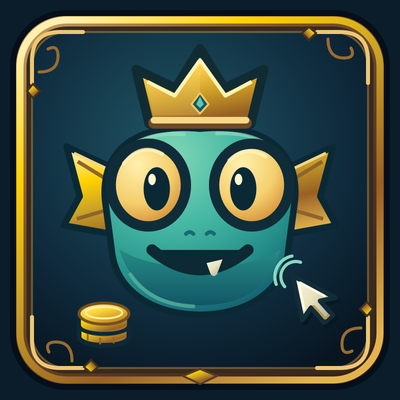
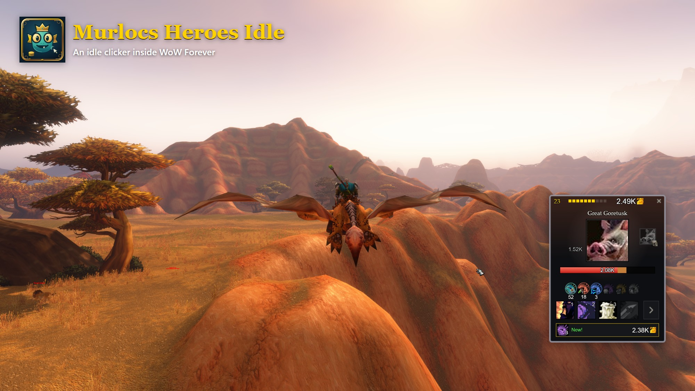
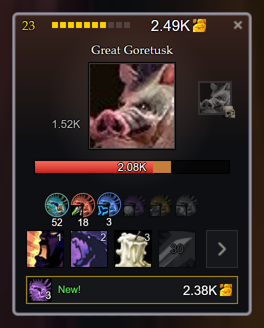
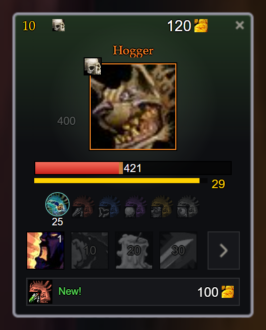
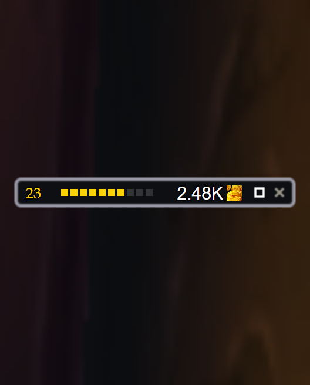
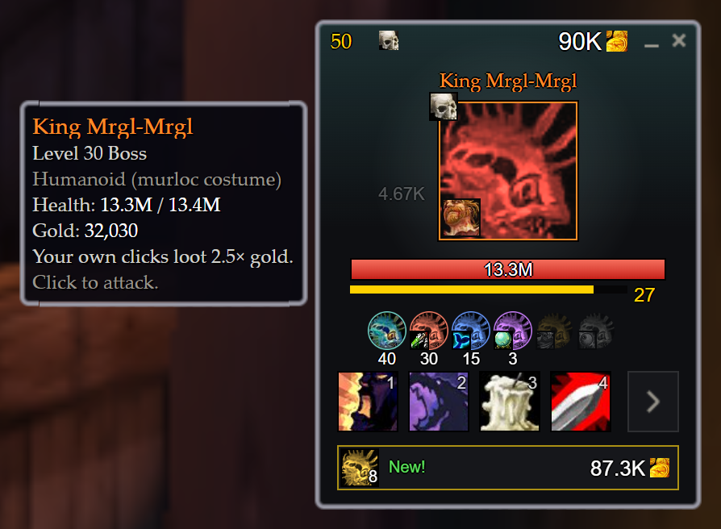
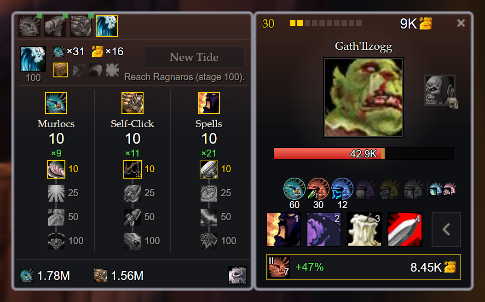

  

<h1 align="center">Murlocs Heroes Idle</h1>

  <b>A murloc squad fights in a small window while you quest.</b> 
  An idle clicker addon for WoW Forever. How far can your squad get?

  

## What you get

- **A murloc squad.** Hire six kinds of murlocs. They fight on their own.
- **Click to help.** Four abilities, from MRGLGLGL! to LEEROY!
- **Bosses.** From Hogger to Ragnaros and Nefarian, one at the end of each zone.
- **King Mrgl-Mrgl.** He waits at stage 50.
- **Rares.** Find two named rares in every zone.
- **New Tide.** Stuck? Start over with your Tide points and get much further.
- **Your adventure counts.** Quests, level-ups and new zones give the squad bonus gold.
- **Offline gold.** Logged out? Your squad still earns gold at half speed, for up to 8 hours.

  
  
  

## How to play

1. Click the enemy and hire your first murloc.
2. Keep hiring. **Buy best** picks the best deal for you.
3. Beat the boss at the end of each zone, up to Ragnaros at stage 100.
4. The first time you reach stage 100, 120, 140 and so on, you earn a **Tide point**.
5. Stuck at a boss? Start a **New Tide**. Put your points into Murlocs, Self-Click or Spells, start over much stronger and beat your record.

## Plays inside WoW

- No sound.
- Minimize it to a slim bar.
- Calm mode shows fewer numbers and coins.
- It never touches your character, bags or real gold.

  
  

## Install

1. Download the zip from CurseForge or from this repository.
2. Copy the `MrglSquad` folder into `_forever_\Interface\AddOns`.
3. Restart WoW and type `/mhi`.

Works on **WoW Forever** only. Other clients are not supported.

## Commands

| Command | What it does |
|---|---|
| `/mhi` | Open or close the window |
| `/mhi min` | Minimize or restore |
| `/mhi minimap` | Show or hide the minimap button |
| `/mhi reset` | Move the window back to its default place |

You can also set key bindings under *Key Bindings, AddOns*.

## Bugs and ideas

Found a bug or have an idea? [Open an issue](https://github.com/janstfr/murlocs-heroes-idle/issues).

Pull requests are welcome on the `develop` branch. `main` holds the version that is live on CurseForge.

## License

[Creative Commons BY-NC-SA 4.0](https://creativecommons.org/licenses/by-nc-sa/4.0/). You may change and share it with credit, but not sell it.

World of Warcraft and its icons belong to Blizzard Entertainment. This is a fan project and not affiliated with Blizzard.
